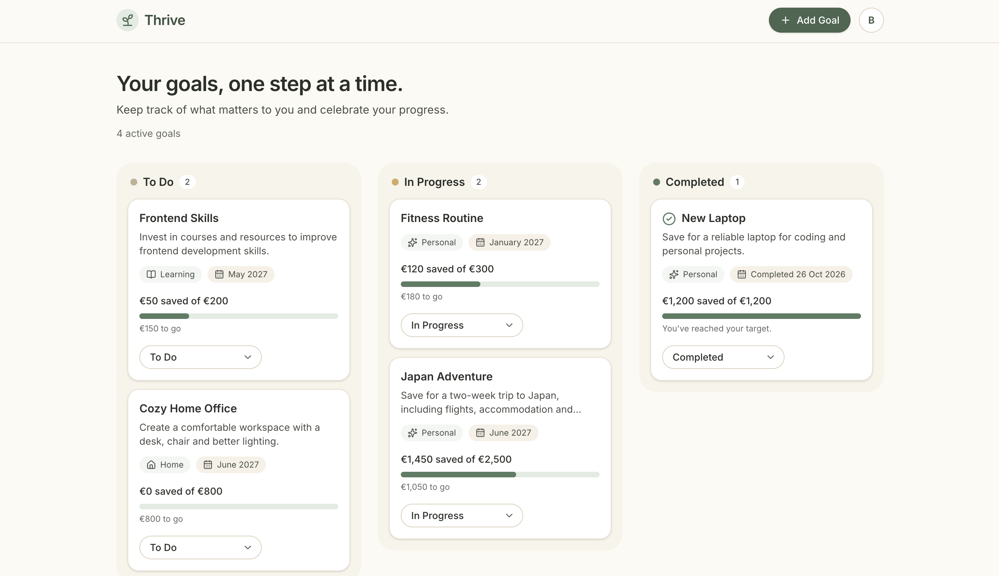
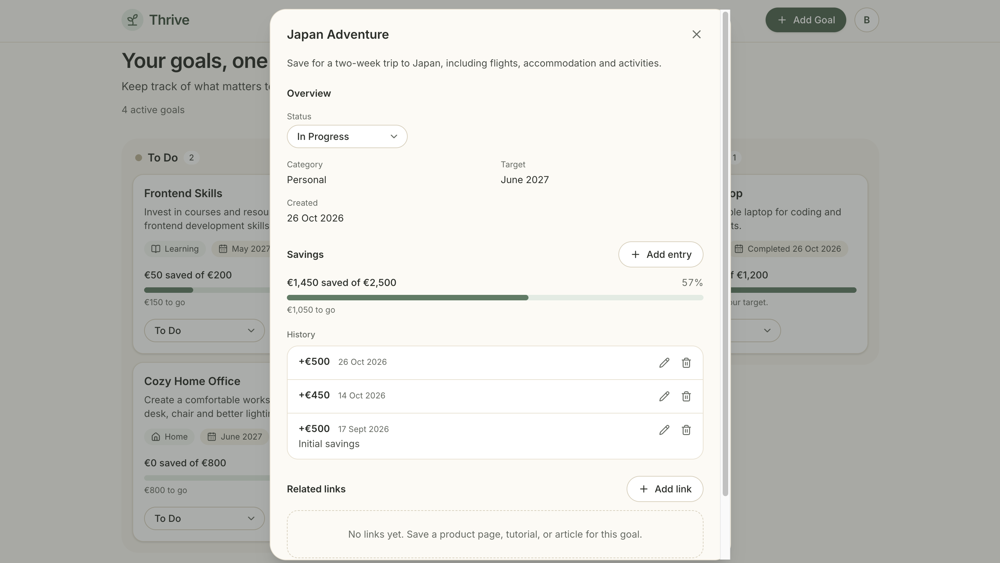

# Thrive

A calm personal space for the things you want to achieve. Thrive tracks
practical goals (a new sofa, a bathroom renovation) and personal ones (read a
book, learn a skill), with optional manual savings tracking toward each goal.

**Live demo:** <https://thrive-smoky-one.vercel.app/> **



<p>
  
  
</p>

## Features

- **Three-column board:** To Do, In Progress, Completed. Completing a goal
  never deletes it; completed goals stay as an archive.
- **Goals:** title, notes, category, and either a target date or a target month.
  All of it is optional except the title.
- **Savings tracking:** optional euro target per goal, manual deposits and
  withdrawals with notes and dates, progress calculated from the entries
  (never stored). The progress bar caps at 100% while the real total stays
  accurate, and savings can never drop below zero.
- **Related links:** add, edit, and delete links per goal. Only `http(s)`
  addresses are accepted, and they open in a new tab with safe attributes.
- **Accounts:** email and password sign-up with email confirmation, Google
  sign-in, password reset, persistent sessions, and protected routes.
- **Responsive and accessible:** works from phones to desktops, with keyboard
  navigation, labelled forms and dialogs, a skip link, and reduced-motion support.

## Tech stack

| Area | Choice |
| --- | --- |
| Frontend | React, TypeScript, Vite, Tailwind CSS v4, React Router, Lucide icons |
| Backend | Supabase (PostgreSQL, Auth, Row Level Security) |
| Tooling | npm, ESLint, Vitest, GitHub Actions |
| Hosting | Vercel |

There is no custom server and no global state library: React state and small
hooks are enough for this app.

## Architecture

```
Browser (React + TypeScript)
  components -> hooks -> services -> Supabase client
                                        |
                                        v
                                   Supabase
                          Auth + PostgreSQL + RLS
```

- Components never call Supabase directly. Only the `services/` layer does,
  behind a `GoalService` interface.
- Business logic (savings maths, validation, URL safety, formatting) lives in
  pure functions under `src/utils/` and is unit tested.

```
src/
  components/   layout, goals, savings, links, auth, ui
  context/      auth provider
  hooks/        useGoals, useToast, useAuth, useConfirmAction
  lib/          Supabase client
  pages/        dashboard and auth pages
  services/     goal and auth services (all Supabase access)
  types/        shared TypeScript types
  utils/        formatting, validation, savings calculations
supabase/
  migrations/   SQL schema, constraints, triggers, RLS policies
  tests/        database checks (isolation and savings rules)
```

## Data and security

- **Tables:** `profiles`, `goals`, `goal_links`, `savings_entries`.
- **Row Level Security** is enabled on every table. Users can only read and
  change their own rows, and child rows must belong to a goal the user owns
  (enforced by policies and a composite foreign key). Signed-out visitors have
  no table privileges at all.
- **Rules enforced in the database**, not only in the UI: valid statuses and
  categories, positive targets, `http(s)`-only link addresses, no future-dated
  entries, and a savings total that can never go below zero, including under
  concurrent requests. `completed_at` and `updated_at` are set by triggers.
- **Deployment headers:** Content Security Policy, `X-Frame-Options`,
  `X-Content-Type-Options`, `Referrer-Policy`, and `Permissions-Policy`
  (see `vercel.json`).
- Only the Supabase publishable key is used in the browser. No secret or
  service-role key exists in this repository.

## Getting started

**Prerequisites:** Node.js 20.19+ (or 22.12+), a free Supabase account, and
optionally a Google Cloud project for Google sign-in.

```bash
git clone https://github.com/koni-chiwa73/Thrive.git
cd Thrive
npm install
cp .env.example .env.local
```

1. **Create a Supabase project** and copy its Project URL and publishable key
   into `.env.local`:
   ```
   VITE_SUPABASE_URL=https://your-project-ref.supabase.co
   VITE_SUPABASE_PUBLISHABLE_KEY=sb_publishable_...
   ```
2. **Create the database:** open the Supabase SQL Editor and run
   `supabase/migrations/20261021120000_initial_schema.sql` once, in full.
3. **Verify it:** create two test users under Authentication > Users, paste
   their IDs into `supabase/tests/database_checks.sql`, and run it. A message
   starting with `ALL CHECKS PASSED` means every rule works (the error is
   intentional; it rolls the test data back).
4. **Configure Auth:** under Authentication > URL Configuration, set the Site
   URL to `http://localhost:5173` and add `http://localhost:5173/**` as a
   redirect URL.
5. *(Optional)* **Google sign-in:** create an OAuth client in Google Cloud,
   add Supabase's callback URL as an authorized redirect URI, and enter the
   client ID and secret in Supabase under Authentication > Providers > Google.
6. **Run it:**
   ```bash
   npm run dev
   ```

## Scripts

| Command | What it does |
| --- | --- |
| `npm run dev` | Start the dev server |
| `npm run build` | Type-check and build for production |
| `npm run preview` | Preview the production build locally |
| `npm run lint` | Run ESLint |
| `npm test` | Run the unit tests |

## Testing

- **Unit tests** (Vitest) cover savings calculations, form validation, URL
  safety, and formatting.
- **Database checks** (`supabase/tests/database_checks.sql`) verify data
  isolation between users, the savings rules, and cascade deletes.
- **CI** runs lint, tests, and a production build on every push.
- A manual QA checklist covers the user flows, responsive layouts, and
  accessibility.

## Deployment

The app is deployed on Vercel from the `main` branch.

1. Import the repository in Vercel (the Vite preset is detected automatically).
2. Add `VITE_SUPABASE_URL` and `VITE_SUPABASE_PUBLISHABLE_KEY` as environment
   variables. They are baked in at build time, so redeploy after changing them.
3. In Supabase, set the Site URL to the live address and add
   `https://<your-app>.vercel.app/**` as a redirect URL.
4. For Google sign-in, add the live address as an authorized JavaScript origin
   on the Google OAuth client.

`vercel.json` provides the single-page-app fallback and security headers.

## Known limitations

- No drag and drop between columns; status changes use a selector.
- No search or filtering.
- Euros only.
- The default Supabase email service is intended for testing and sends very
  few emails per hour. A real launch would use a custom SMTP provider.
- No CAPTCHA or custom rate limiting beyond Supabase's defaults.
- Supabase stores the session in browser storage (standard for Supabase), so
  a Content Security Policy and never rendering untrusted HTML are the main
  protections against token theft.
- Out of scope by design: bank integrations, notifications, recurring tasks,
  social features, and native apps.

## Possible next steps

Drag and drop, search and filters, custom SMTP, end-to-end browser tests, and
generated database types.

## License

This project is licensed under the MIT License. See the [LICENSE](LICENSE) file for details.